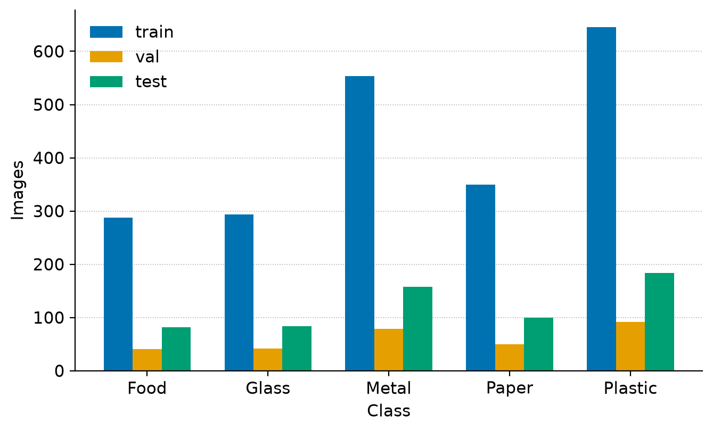
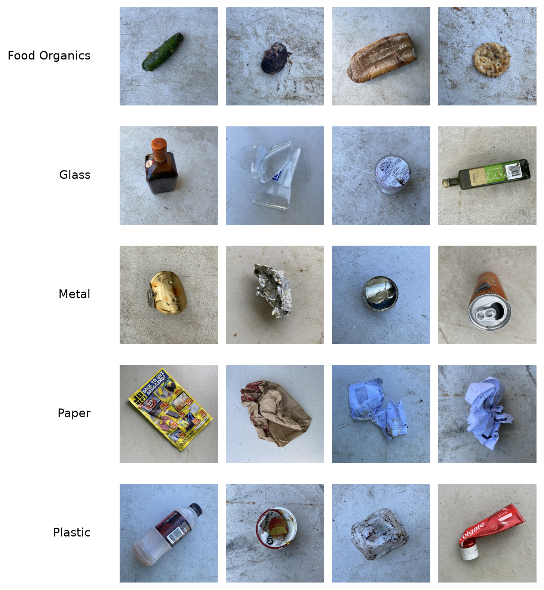
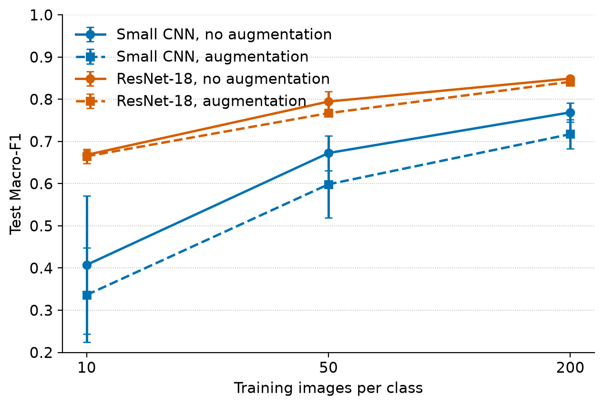
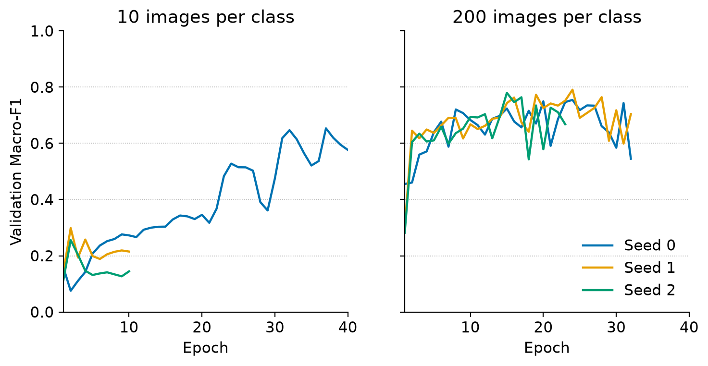
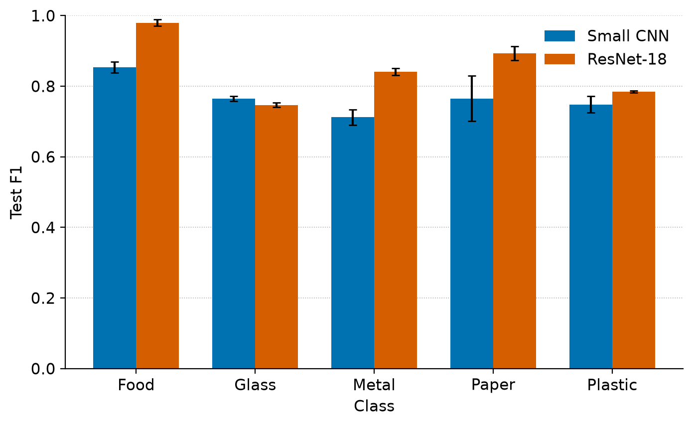
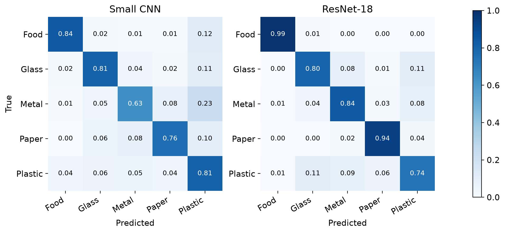

# 有限训练数据下的垃圾图像分类

## 摘要

本实验在 RealWaste 的五个类别上比较两种模型：从零训练的小型卷积神经网络，以及冻结骨干、只训练最后一层的 ImageNet ResNet-18。每个类别的训练图像分别限制为 10、50 和 200 张，并同时比较有无轻度数据增强。划分固定，验证集和测试集不随训练样本量变化。主指标是 Macro-F1，即五个类别 F1 的简单平均。每种设定用三个种子重复。36 次训练全部结束后，测试集只评估一次。

测试集上，每类 200 张且无增强时，ResNet-18 的 Macro-F1 为 0.849 ± 0.005，小 CNN 为 0.769 ± 0.023。训练图像从每类 10 张增加到 200 张时，两个模型都提高。预训练带来的优势在数据最少时最大：每类 10 张的 ResNet-18 已达到 0.668 ± 0.011，而同规模的小 CNN 只有 0.408 ± 0.164，并且三次重复差得很大。本实验使用的水平翻转、15° 旋转和亮度抖动没有提高测试 Macro-F1。按类别看，ResNet-18 的主要收益在 Food Organics、Paper 和 Metal；Glass、Metal 和 Plastic 之间仍然互相混淆。

## 1 引言

把废品按材料分开，是回收流程里的一个具体识别问题。模型需要判断一张照片里的物品主要是厨余、玻璃、金属、纸还是塑料。如果训练图像来自干净背景上的标准商品图，模型和真实分拣场景会差得很远。RealWaste 收集的是填埋场环境中的真实照片，物品会被压扁、弄脏、部分遮挡，同一类别内部的外形差别也很大 [1]。

标注这样的照片需要人工判断材料，成本高。一个实际的问题是：每一类只能拿到很少的标注时，应该从零训练一个小网络，还是直接使用在大规模自然图像上已经学好的特征。本实验把这个问题收成三个可以分开观察的因素。

1. 模型容量和权重来源。小 CNN 的全部参数都在垃圾图像上学习。ResNet-18 的卷积特征来自 ImageNet-1K，垃圾图像上只学习一个新的五类线性层。
2. 训练规模。每类使用 10、50 或 200 张，并且小集合是大集合的前缀。规模变大时，增加的是图像，验证集和测试集保持不动。
3. 输入扰动。一组实验关闭增强，另一组只在训练图像上做水平翻转、±15° 旋转和亮度抖动。

三个因素交叉之后共有 12 种设定。每种设定用种子 0、1、2 各训练一次，得到 36 个权重。早停只看验证集 Macro-F1。测试集留到全部权重保存之后使用一次，用来报告最终分数，也用来检查验证集上的排序是否还成立。

实验要回答的具体问题是：

- 每类训练图像从 10 张增加到 200 张，Macro-F1 提高多少。
- 冻结的预训练特征相对于从零训练，在哪个规模上帮助最大。
- 这一组固定的增强是否提高测试分数。
- 总体分数背后，哪些类别容易分对，哪些类别互相认错。
- 换一份训练子集、换一次初始化之后，结论还稳不稳。

## 2 数据

### 2.1 来源与保留的类别

图像来自 RealWaste [1]。原数据集面向填埋场废品分类，本实验保留其中五个材料类别：Food Organics、Glass、Metal、Paper、Plastic，共 3042 张 JPEG。测量结果显示这些发布图像都是 524×524。Cardboard、Miscellaneous Trash、Textile Trash 和 Vegetation 没有下载，因此后面的结论只覆盖这五种材料。

没有做近重复图像清理。同一物品如果被连拍多次，相似照片可能分别进入训练集和测试集，测试分数会因此偏高。这个限制留到第 6 节讨论。数据集许可证为 CC BY-NC-SA 4.0，再分发时需要保留署名、限于非商业用途，并以相同方式共享。

### 2.2 为什么按类别分层

五个类别的原始数量并不相等。Plastic 有 921 张，Metal 有 790 张，Paper 有 500 张，Glass 有 420 张，Food Organics 有 411 张。如果把全部图像混在一起再随机切开，小类别有可能在验证集或测试集里只剩下很少的样本，某一类的 F1 会变得很难解释。分层的做法是每个类别自己切开，使训练、验证、测试里都保留全部五个类别，而且各类的比例与原始数据接近。

划分只做一次，种子为 42。每个类别先按文件名排序，再用一个以 42 为起点的随机数生成器打乱。测试张数等于该类总张数乘以 0.2 后四舍五入，验证张数等于总张数乘以 0.1 后四舍五入，剩下的进入训练集。五个类别各自使用同一个种子，但各自独立打乱，因为每个类别的文件列表不同。划分结果见表 1，柱状图见图 1。合计为训练集 2130 张、验证集 304 张、测试集 608 张。

表 1 各类别的划分张数

| 类别 | 训练 | 验证 | 测试 | 合计 |
| --- | ---: | ---: | ---: | ---: |
| Food Organics | 288 | 41 | 82 | 411 |
| Glass | 294 | 42 | 84 | 420 |
| Metal | 553 | 79 | 158 | 790 |
| Paper | 350 | 50 | 100 | 500 |
| Plastic | 645 | 92 | 184 | 921 |
| 合计 | 2130 | 304 | 608 | 3042 |

验证集和测试集保留了原始的不平衡：测试集里 Plastic 有 184 张，Food Organics 只有 82 张。后面报告 Macro-F1 而不是准确率，就是为了避免大类别单独决定总分。训练子集则在每个类别里取相同张数，使“每类 10 张”真正表示五个类别各 10 张，而不是从 2130 张里随便抽 50 张。

全部训练池有 2130 张，但本实验最大的训练条件是每类 200 张，一共 1000 张。五个类别的训练池都不少于 288 张，所以 200 张的子集可以抽出来。实验没有再训练“使用全部 2130 张”的模型。200 张是本协议里的大样本条件，不是把数据用尽。

### 2.3 图像长什么样

图 2 从测试集的每个类别里按文件名排序后等间隔取四张。Food Organics 里既有完整的食物，也有很小的残渣。Glass 里既有完整瓶子，也有碎玻璃。Metal 里有完整的罐，也有被压扁的罐和金属片。Paper 既有较完整的印刷品，也有揉成团的纸。Plastic 包含瓶子、杯、包装和软管。拍摄角度大体是俯拍，背景常常是相近的地面，但物品的完整程度、污渍和形变差别很大。这些差异说明，即使用同一个类别标签，模型也要覆盖多种外形。

### 2.4 嵌套的训练子集

比较“10 张、50 张、200 张”时，如果三份名单互不相交，分数变化可能来自“恰好抽到了更容易或更难的图像”，而不只是来自数量。嵌套子集把这件事固定下来。种子 0、1、2 各自从训练集抽一份名单，写入 `splits/subsets.json` 后不再重抽。

每个种子使用一条连续的随机序列。类别顺序固定为 Food Organics、Glass、Metal、Paper、Plastic。对某一个类别，先得到该类别训练图像的一个排列，再取这个排列的前 200 张、前 50 张和前 10 张。因此前 10 张一定包含在前 50 张里，前 50 张一定包含在前 200 张里。从 10 张改到 50 张，是在原有 10 张上追加 40 张；从 50 张改到 200 张，是再追加 150 张。验证集 304 张和测试集 608 张对所有训练规模都相同。

训练命令里的 `--seed` 与子集种子是同一个整数。它同时做三件事：选出 `subsets.json` 里的那一份名单；设定 Python 和 PyTorch 的随机数起点，从而决定新层的初始权重；决定每个 epoch 里图像的打乱顺序，以及增强开启时每次随机翻转、旋转和亮度的取值。种子 0 的“每类 50 张”和种子 1 的“每类 50 张”不是同一批图像，模型的初始值也不一样。三次重复用来观察这个差别有多大。

## 3 方法

### 3.1 从文件到张量

训练、验证和测试使用同一套几何处理：把 524×524 的图像缩放成 224×224，转成 RGB 三通道张量，再按 ImageNet 的均值 (0.485, 0.456, 0.406) 和标准差 (0.229, 0.224, 0.225) 做归一化。原始 JPEG 不改写。224 这个边长和这组均值、标准差与 ResNet-18 的预训练输入一致 [2,3]。小 CNN 也使用同一套预处理，这样两个模型看到的像素分布相同，差别来自网络和权重，而不是来自不同的缩放方式。

增强只加在训练集上，并且发生在缩放之后、转为张量之前。三种变换是：以 0.5 的概率水平翻转；在 ±15° 内随机旋转；亮度在 0.8 到 1.2 倍之间抖动。验证和测试明确禁止增强。同一张训练图像在不同 epoch 会得到不同的增强结果，这个随机序列由该次运行的种子决定。

### 3.2 小型 CNN

小 CNN 不加载外部权重。输入是 \(3 \times 224 \times 224\)。网络由三个相同结构的模块串联而成，每个模块是：

1. \(3 \times 3\) 卷积，padding 为 1，步长为 1，因此空间尺寸不变；
2. BatchNorm，再接 ReLU；
3. \(2 \times 2\) 最大池化，边长减半。

三个模块的输出通道依次是 32、64、128。一张图像经过三次池化后，特征图为 \(128 \times 28 \times 28\)。自适应全局平均池化把每个通道收成一个数，得到 128 维向量，再由 `Linear(128 → 5)` 输出五个类别的 logits。全部参数都参与更新，数量为 94,341。这个网络没有残差连接，深度也只有三层卷积，用来代表“数据很少时可以从头训练的轻量模型”，不是用来逼近 ResNet 的层数。

### 3.3 冻结骨干的 ResNet-18

第二个模型采用 ResNet-18 [2]。它的基本单元是两层 \(3 \times 3\) 卷积加上一条捷径：输入可以直接加到两层卷积的输出上，从而减轻深层网络训练时的退化。标准 ResNet-18 先用步长为 2 的 \(7 \times 7\) 卷积和一次最大池化降低分辨率，再经过四个阶段，通道数依次为 64、128、256、512，每个阶段两个基本单元。全局平均池化之后得到 512 维特征。

本实验加载 torchvision 的 `IMAGENET1K_V1` 权重，对应在 ImageNet-1K 上预训练的 ResNet-18 [3]。原来的 1000 类全连接层换成 `Linear(512 → 5)`。新层有 \(512 \times 5 + 5 = 2565\) 个可训练参数。骨干共 11,176,512 个参数，梯度关闭，数值在垃圾图像上不更新。

BatchNorm 还会保存训练过程中的均值和方差 [6]。如果让冻结的骨干处于 train 状态，这批很小的垃圾图像会改写 ImageNet 上学到的运行统计量，特征会离开预训练时的分布。因此训练 ResNet 时，整个网络保持 eval 状态，只有新的线性层处于 train 状态。验证和测试时两个模型都处于 eval 状态。

这个设定衡量的是“现成特征加一个线性分类器”，不是“把整个 ResNet 在垃圾图像上继续训练”。骨干微调有可能在每类 200 张时进一步提高分数，但那是另一个实验，本报告的数字不能代表微调后的结果。

### 3.4 损失、优化和早停

两个模型都把 logits 和整数类别标签送入交叉熵损失。优化器是 AdamW [4]，权重衰减为 \(10^{-4}\)，批大小为 32。小 CNN 的学习率是 \(10^{-3}\)，因为它更新全部卷积层。ResNet-18 新层的学习率是 \(10^{-2}\)，因为需要更新的只有一个线性层，特征本身不动。这组学习率、权重衰减、批大小、最大轮数和早停耐心在 36 次运行中保持不变，没有根据测试集再搜索。

一次运行的过程如下。

1. 用该次种子设置随机数起点，并读取对应的训练子集。每类 10、50、200 张时，训练集分别有 50、250、1000 张图像。验证集始终是 304 张。
2. 每个 epoch 先打乱训练集。小 CNN 以 train 模式前向、反传、更新。ResNet-18 按上一节的方式只更新最后一层。
3. 同一轮再用当前权重在验证集上前向一次，不做增强，计算验证损失和验证 Macro-F1。
4. 若验证 Macro-F1 严格大于历史最好值，就记下这一轮的权重。相等不算提高。
5. 若连续 8 个 epoch 没有刷新最好值，就停止。最多训练 40 个 epoch。停止后把权重恢复成验证分数最高的那一轮，而不是最后一轮。

每类 10 张时，一个 epoch 只有两批（50 张，批大小 32）。每类 200 张时大约有 32 批。验证集大约有 10 批。因此“40 个 epoch”对两种样本量的含义不同：小样本看到的图像次数少，大样本每一轮的梯度步数更多。早停用的是完整验证集，不是训练损失。训练损失在小样本上很容易降得很低，但不能说明五个类别在没见过的图像上都能分开。

测试集在这一阶段不读取。权重文件只保存模型名、种子、每类张数、是否增强、最好轮次、最好验证 Macro-F1、每一轮的历史和参数。

### 3.5 Macro-F1 怎么计算，为什么用它

预测类别取 logits 最大的那一类。对类别 \(c\)，记真正属于 \(c\) 且预测也是 \(c\) 的张数为 TP，预测为 \(c\) 的张数为预测数，真正属于 \(c\) 的张数为实际数。精确率和召回率是：

\[
\mathrm{Precision}_c = \frac{\mathrm{TP}_c}{\text{预测为 } c \text{ 的张数}}, \qquad
\mathrm{Recall}_c = \frac{\mathrm{TP}_c}{\text{真正属于 } c \text{ 的张数}}
\]

若分母为 0，该项记为 0。F1 是二者的调和平均 [5]：

\[
\mathrm{F1}_c = \frac{2 \cdot \mathrm{Precision}_c \cdot \mathrm{Recall}_c}{\mathrm{Precision}_c + \mathrm{Recall}_c}
\]

精确率和召回率只要有一个接近 0，F1 就接近 0。一个模型如果把某个类别全部漏掉，该类 F1 就是 0，不会因为其他类别分对而被掩盖。Macro-F1 是五个 F1 的算术平均：

\[
\mathrm{Macro\text{-}F1} = \frac{1}{5}\sum_{c=1}^{5}\mathrm{F1}_c
\]

五个类别的投票相同。测试集里 Plastic 有 184 张、Food Organics 有 82 张，若使用准确率，Plastic 上的对错会占更大比重。Macro-F1 让 Glass 的失败和 Plastic 的失败以同样的权重进入总分。早停、保存权重和报告主结果都使用它。各类 F1 和混淆矩阵用来解释这个平均数是怎么来的。

混淆矩阵在第 5.3 节按行归一化。行是真实类别，列是预测类别，一行的合计为 1。对角线上的数是召回率，不是 F1，也不是精确率。一行里最大的非对角数，就是这个类别最常被错认成的类别。

## 4 实验设置

表 2 汇总 36 次运行共用的协议。变化的只有模型、每类张数、增强开关和种子。

表 2 固定的训练协议

| 项目 | 设置 |
| --- | --- |
| 类别 | Food Organics、Glass、Metal、Paper、Plastic |
| 输入 | 缩放到 224×224，ImageNet 归一化 |
| 训练规模 | 每类 10、50、200 张，嵌套 |
| 验证 / 测试 | 304 张 / 608 张，全部运行共用 |
| 优化器 | AdamW，权重衰减 \(10^{-4}\)，批大小 32 |
| 学习率 | 小 CNN 为 \(10^{-3}\)，ResNet-18 头为 \(10^{-2}\) |
| 轮数 | 最多 40，验证 Macro-F1 连续 8 轮不提高则停止 |
| 重复 | 种子 0、1、2 |
| 设备 | NVIDIA GeForce RTX 3060 Laptop GPU |

36 个权重全部保存之后，才在测试集上逐个前向。测试批大小同样是 32，不打乱、不增强。每次得到测试 Macro-F1、五个类别的 F1 和 \(5 \times 5\) 的计数矩阵。汇总时对同一设定的三个种子取平均，波动用样本标准差表示，分母是 \(3-1=2\)。混淆矩阵先把三个种子的计数相加，再按行归一化。因为三次评估用的是同一批 608 张测试图像，这个矩阵表示三次预测合在一起后的比例，不是三个不同测试集的平均。

## 5 结果

### 5.1 主结果：规模、预训练和增强

表 3 和图 3 是测试集 Macro-F1。图中四条线对应两个模型和两种增强，误差线是三个种子的样本标准差。

表 3 测试集 Macro-F1，三个种子的均值 ± 样本标准差

| 每类训练张数 | 小 CNN，无增强 | 小 CNN，有增强 | ResNet-18，无增强 | ResNet-18，有增强 |
| --- | ---: | ---: | ---: | ---: |
| 10 | 0.408 ± 0.164 | 0.336 ± 0.112 | 0.668 ± 0.011 | 0.665 ± 0.017 |
| 50 | 0.673 ± 0.041 | 0.598 ± 0.079 | 0.794 ± 0.024 | 0.767 ± 0.005 |
| 200 | 0.769 ± 0.023 | 0.717 ± 0.035 | 0.849 ± 0.005 | 0.841 ± 0.004 |

先看无增强的两条实线。小 CNN 从每类 10 张的 0.408 升到 50 张的 0.673，再升到 200 张的 0.769。前一段增加 0.265，后一段增加 0.096。ResNet-18 从 0.668 升到 0.794，再升到 0.849，两段分别增加 0.126 和 0.055。数量增加对两个模型都有用，但新增同样多的图像时，起点更低的小 CNN 提升更大。ResNet-18 在 50 张之后仍在上升，只是斜率变小。

再看两个模型的垂直距离。无增强时，每类 10 张相差 0.260，每类 50 张相差 0.122，每类 200 张相差 0.080。预训练的优势一直存在，并且数据越少越大。每类 10 张的 ResNet-18（0.668）已经和每类 50 张的小 CNN（0.673）处在同一水平。也就是说，在这个五类任务上，一组固定的 ImageNet 特征加上线性层，大约相当于把从零训练的小 CNN 再多给每类 40 张图像。这个对照只在本协议的两个模型之间成立。

增强对应图 3 里的虚线。把同一模型、同一规模的增强均值减去无增强均值，六个差值都是负数：小 CNN 在 10、50、200 张时分别为 −0.071、−0.074、−0.052；ResNet-18 分别为 −0.003、−0.027、−0.008。下降最大的一格是每类 50 张的小 CNN，从 0.673 降到 0.598。ResNet-18 在每类 10 张和 200 张时，增强与否几乎重叠，误差线也短。因此，就这一组变换、这一组学习率和这一次测试而言，增强没有带来 Macro-F1 上的收益。它也没有改变两条曲线的排序：ResNet-18 仍高于小 CNN，200 张仍高于 50 张和 10 张。

### 5.2 三十六次运行

表 3 把每个格子收成一个平均数。表 4 到表 6 列出全部 36 次的最好轮次、验证 Macro-F1 和测试 Macro-F1。最好轮次是验证分数达到最高的那一轮，不是训练停止的那一轮。停止轮次等于最好轮次再加 8，但不会超过 40。

表 4 每类 10 张的三次重复

| 模型 | 增强 | 种子 | 最好轮次 | 验证 Macro-F1 | 测试 Macro-F1 |
| --- | --- | ---: | ---: | ---: | ---: |
| 小 CNN | 无 | 0 | 37 | 0.653 | 0.594 |
| 小 CNN | 无 | 1 | 2 | 0.299 | 0.340 |
| 小 CNN | 无 | 2 | 2 | 0.256 | 0.289 |
| 小 CNN | 有 | 0 | 39 | 0.565 | 0.465 |
| 小 CNN | 有 | 1 | 4 | 0.252 | 0.277 |
| 小 CNN | 有 | 2 | 2 | 0.235 | 0.267 |
| ResNet-18 | 无 | 0 | 9 | 0.701 | 0.658 |
| ResNet-18 | 无 | 1 | 16 | 0.672 | 0.668 |
| ResNet-18 | 无 | 2 | 11 | 0.700 | 0.679 |
| ResNet-18 | 有 | 0 | 27 | 0.688 | 0.683 |
| ResNet-18 | 有 | 1 | 31 | 0.667 | 0.651 |
| ResNet-18 | 有 | 2 | 17 | 0.684 | 0.660 |

表 5 每类 50 张的三次重复

| 模型 | 增强 | 种子 | 最好轮次 | 验证 Macro-F1 | 测试 Macro-F1 |
| --- | --- | --- | ---: | ---: | ---: |
| 小 CNN | 无 | 0 | 35 | 0.734 | 0.718 |
| 小 CNN | 无 | 1 | 14 | 0.701 | 0.662 |
| 小 CNN | 无 | 2 | 7 | 0.657 | 0.637 |
| 小 CNN | 有 | 0 | 24 | 0.700 | 0.689 |
| 小 CNN | 有 | 1 | 12 | 0.617 | 0.538 |
| 小 CNN | 有 | 2 | 23 | 0.626 | 0.568 |
| ResNet-18 | 无 | 0 | 6 | 0.792 | 0.769 |
| ResNet-18 | 无 | 1 | 15 | 0.800 | 0.797 |
| ResNet-18 | 无 | 2 | 13 | 0.807 | 0.817 |
| ResNet-18 | 有 | 0 | 17 | 0.801 | 0.761 |
| ResNet-18 | 有 | 1 | 15 | 0.805 | 0.771 |
| ResNet-18 | 有 | 2 | 16 | 0.799 | 0.769 |

表 6 每类 200 张的三次重复

| 模型 | 增强 | 种子 | 最好轮次 | 验证 Macro-F1 | 测试 Macro-F1 |
| --- | --- | --- | ---: | ---: | ---: |
| 小 CNN | 无 | 0 | 24 | 0.754 | 0.759 |
| 小 CNN | 无 | 1 | 24 | 0.791 | 0.795 |
| 小 CNN | 无 | 2 | 15 | 0.780 | 0.752 |
| 小 CNN | 有 | 0 | 21 | 0.718 | 0.695 |
| 小 CNN | 有 | 1 | 35 | 0.754 | 0.699 |
| 小 CNN | 有 | 2 | 31 | 0.771 | 0.758 |
| ResNet-18 | 无 | 0 | 16 | 0.873 | 0.854 |
| ResNet-18 | 无 | 1 | 3 | 0.839 | 0.844 |
| ResNet-18 | 无 | 2 | 6 | 0.842 | 0.849 |
| ResNet-18 | 有 | 0 | 4 | 0.867 | 0.837 |
| ResNet-18 | 有 | 1 | 14 | 0.835 | 0.845 |
| ResNet-18 | 有 | 2 | 10 | 0.839 | 0.842 |

这三张表里，同一个格子内 ResNet-18 的三次测试分数都高于同种子的小 CNN。没有出现“某一次小 CNN 反超同一次 ResNet-18”的情况。小 CNN 在每类 10 张时的内部差距则很大：无增强的三个测试分数是 0.594、0.340 和 0.289。种子 1 和种子 2 在第 2 轮就达到了自己的最好验证分数。ResNet-18 在同一规模的三次测试分数是 0.658、0.668 和 0.679，最好轮次落在第 9 到第 16 轮。

每类 200 张时，ResNet-18 无增强的最好轮次是 16、3 和 6。最后一层在几千步之内就到达验证上的高点，之后 8 轮不刷新便停止。小 CNN 无增强的最好轮次是 24、24 和 15，卷积层需要更长的训练才出现最佳验证分数。这个差别和两者可训练参数的角色一致：前者只拟合一个线性层，后者要同时形成特征。

### 5.3 验证曲线上的早停

图 4 把无增强小 CNN 的验证 Macro-F1 按 epoch 画出来。左图是每类 10 张，右图是每类 200 张，三条线是三个种子。横轴固定到 40，短线表示提前停止。

左图里种子 0 从大约 0.1 缓慢升到 0.6 附近，并在第 37 轮取得最好成绩，因此会把 40 个 epoch 用完。种子 1 和种子 2 只在前几个 epoch 有一小段上升，最好值停在 0.30 和 0.26 左右，曲线随之结束。右图里三个种子都在前几个 epoch 进入 0.5 以上，随后在 0.6 到 0.8 之间波动，并各自在第 15 到第 24 轮达到最高点。波动说明验证 Macro-F1 并不是单调上升的，所以保留历史最好权重，而不是保留最后一轮，会改变最终使用的参数。

每类 10 张时的不稳定不只出现在总分上，也出现在单个类别上。无增强小 CNN 的种子 1 对 Glass 的测试 F1 为 0，对 Paper 只有 0.020；种子 2 对 Plastic 的测试 F1 为 0。F1 为 0 表示该类没有真正例：要么一张都没预测成这个类别，要么预测成这个类别的图像全部是错的。三次里有一次能到达测试 Macro-F1 0.594，另外两次则在至少一个类别上完全失败。只报告一次运行，会把这两种情况混成一个不可复现的数字。

### 5.4 验证集选择和测试集分数是否一致

权重由验证 Macro-F1 选出，测试分数是在这组权重上看一次未见数据。表 7 比较每个设定上三个种子的验证均值和测试均值。差值为验证减去测试，正数表示验证高于测试。

表 7 验证均值与测试均值

| 设定 | 验证均值 | 测试均值 | 验证 − 测试 |
| --- | ---: | ---: | ---: |
| 小 CNN，10 张，无增强 | 0.403 | 0.408 | −0.005 |
| 小 CNN，10 张，有增强 | 0.351 | 0.336 | +0.015 |
| ResNet-18，10 张，无增强 | 0.691 | 0.668 | +0.022 |
| ResNet-18，10 张，有增强 | 0.680 | 0.665 | +0.015 |
| 小 CNN，50 张，无增强 | 0.697 | 0.673 | +0.025 |
| 小 CNN，50 张，有增强 | 0.648 | 0.598 | +0.049 |
| ResNet-18，50 张，无增强 | 0.800 | 0.795 | +0.005 |
| ResNet-18，50 张，有增强 | 0.802 | 0.767 | +0.035 |
| 小 CNN，200 张，无增强 | 0.775 | 0.769 | +0.006 |
| 小 CNN，200 张，有增强 | 0.748 | 0.717 | +0.031 |
| ResNet-18，200 张，无增强 | 0.851 | 0.849 | +0.002 |
| ResNet-18，200 张，有增强 | 0.847 | 0.841 | +0.006 |

12 个设定里有 11 个的验证均值不低于测试均值，差距最大的是每类 50 张且带增强的小 CNN，验证 0.648，测试 0.598，差 0.049。无增强的 ResNet-18 在三个规模上差距都不超过 0.022，每类 200 张时只有 0.002。验证集和测试集的排序与表 3 一致：同一增强设置下，ResNet-18 高于小 CNN，200 张高于 50 张，50 张高于 10 张。因此早停没有选出一个只在验证集上好看、到测试集上排序颠倒的模型。差距也说明，写进结论的应该是测试集数字；验证集数字已经参与了权重选择。

### 5.5 各类别随训练规模的变化

表 8 给出无增强设定下各类测试 F1 的均值和样本标准差。增强设定的总分已在表 3 中，这里集中看数量增加时每个类别怎么变。

表 8 无增强时各类测试 F1

| 类别 | 模型 | 每类 10 张 | 每类 50 张 | 每类 200 张 |
| --- | --- | ---: | ---: | ---: |
| Food Organics | 小 CNN | 0.505 ± 0.260 | 0.799 ± 0.036 | 0.854 ± 0.016 |
| Food Organics | ResNet-18 | 0.857 ± 0.038 | 0.943 ± 0.011 | 0.980 ± 0.009 |
| Glass | 小 CNN | 0.299 ± 0.263 | 0.639 ± 0.074 | 0.765 ± 0.007 |
| Glass | ResNet-18 | 0.486 ± 0.049 | 0.644 ± 0.077 | 0.747 ± 0.007 |
| Metal | 小 CNN | 0.532 ± 0.071 | 0.624 ± 0.026 | 0.712 ± 0.022 |
| Metal | ResNet-18 | 0.609 ± 0.033 | 0.789 ± 0.020 | 0.841 ± 0.010 |
| Paper | 小 CNN | 0.317 ± 0.276 | 0.609 ± 0.091 | 0.765 ± 0.064 |
| Paper | ResNet-18 | 0.799 ± 0.036 | 0.896 ± 0.016 | 0.893 ± 0.020 |
| Plastic | 小 CNN | 0.385 ± 0.334 | 0.691 ± 0.049 | 0.748 ± 0.023 |
| Plastic | ResNet-18 | 0.590 ± 0.037 | 0.700 ± 0.041 | 0.785 ± 0.003 |

每类只有 10 张时，ResNet-18 已经把 Food Organics 做到 0.857、Paper 做到 0.799，而小 CNN 这两类只有 0.505 和 0.317，标准差都在 0.26 以上。Glass 对两个模型都最难：ResNet-18 为 0.486，小 CNN 为 0.299。预训练并没有让所有类别一起变得容易，它首先稳住的是食物和纸张这类在 ImageNet 特征里更容易分开的外观。

从 10 张到 200 张，Glass 是小 CNN 提升最多的类别，从 0.299 到 0.765。Metal 的提升较小，从 0.532 到 0.712，到了 200 张仍然是小 CNN 五个类别里最低的。ResNet-18 的 Paper 在 50 张时已经是 0.896，到 200 张是 0.893，这一类的分数基本停住；Food Organics 还从 0.943 升到 0.980。Plastic 两个模型都继续上升，200 张时分别是 0.748 和 0.785。

图 5 把每类 200 张、无增强的各类 F1 画成柱状图。ResNet-18 在 Food Organics、Paper、Metal、Plastic 上更高。Glass 是唯一小 CNN 略高的类别，0.765 ± 0.007 对 0.747 ± 0.007。两个标准差都只有 0.007，所以这不是某一次运行的偶然高低，但 0.018 的差距远小于 ResNet-18 在 Food Organics 上大约 0.13 的优势，总分仍然是 ResNet-18 更高。Paper 上小 CNN 的标准差为 0.064，是这一组里种子差异最大的类别。

### 5.6 混淆矩阵

图 6 对应图 5 的同一设定：每类 200 张、无增强，三个种子的计数相加后按真实类别归一化。

小 CNN 的五行召回率是 Food 0.84、Glass 0.81、Metal 0.63、Paper 0.76、Plastic 0.81。Metal 是短板：该行有 0.23 进入 Plastic，0.08 进入 Paper，0.05 进入 Glass。另外四个类别也各有大约 0.10 到 0.12 被预测成 Plastic。Plastic 在测试集中张数最多，小 CNN 倾向于把不确定的圆柱体和碎片预测成这一类。召回率 0.81 只说明真正的塑料里有 81% 被找到；被错认成塑料的金属不会出现在 Plastic 这一行，而会出现在 Metal 这一行。这也是 F1 低于召回率的原因之一：Metal 的召回率只有 0.63，F1 为 0.712，说明精确率高于召回率，但仍然受到漏检的限制。

ResNet-18 把 Food 的召回率提高到 0.99，该行其余格子合计只有 0.01。Paper 的召回率是 0.94，Metal 是 0.84。Metal 被预测成 Plastic 的比例从 0.23 降到 0.08。剩余的主要错误集中在容器类：Glass 有 0.11 被预测成 Plastic、0.08 被预测成 Metal；Plastic 的召回率是五个类别里最低的 0.74，其中 0.11 被预测成 Glass，0.09 被预测成 Metal，0.06 被预测成 Paper。玻璃瓶、金属罐和塑料瓶在俯拍时都可能呈现圆形或圆柱形，图 2 里的样例也有这种外形重叠。Paper 几乎不再被认成 Glass 或 Food，和表 8 里 Paper 的高 F1 一致。

Glass 的召回率两个模型很接近，分别是 0.81 和 0.80。图 5 里小 CNN 的 Glass F1 略高，说明差别主要不在“漏掉了多少玻璃”，而在预测为玻璃的那些图像里有多少是对的。混淆矩阵的行归一化不直接显示这一列的精确率，所以两类图需要一起看。

## 6 讨论

### 6.1 预训练特征在这个任务里提供了什么

ResNet-18 的卷积层在 ImageNet-1K 的约一百万张自然图像上已经形成边缘、纹理和物体局部的响应 [2,3]。垃圾图像虽然领域不同，但瓶子、罐子、纸张和食物仍然包含这些局部结构。冻结骨干之后，垃圾数据只需要学习 512 维特征到五个类别的线性边界。每类 10 张、一共 50 张图像时，2565 个参数的线性层可以拟合，三次测试 Macro-F1 都落在 0.658 到 0.679。小 CNN 的 94,341 个参数要同时产生特征，50 张图像不足以把三个种子都训练到可用的决策面，于是出现 0.289 到 0.594 的分散。

数据增加到每类 200 张后，小 CNN 的测试均值达到 0.769，和 ResNet-18 的差距缩小到 0.080。差距缩小说明额外标注确实在补从小网络缺少的特征，但 1000 张训练图像仍没有让它超过固定的 ImageNet 特征。如果目标只是在标注预算很小的时候先得到一个可用的五类分类器，本实验支持先使用冻结的预训练骨干。如果目标是估计继续标注的价值，表 3 说明从 50 张再到 200 张，ResNet-18 仍有 0.055 的 Macro-F1 提升，小 CNN 有 0.096 的提升，数据还没有饱和到可以停止标注的程度。

### 6.2 为什么这组增强没有提高分数

RealWaste 的照片本身已经包含不同的摆放角度、完整程度和光照，图 2 的样例可以看出来。本实验追加的只是左右翻转、不超过 15° 的旋转和适度的亮度变化，没有裁剪、遮挡、颜色抖动或把多张图混合的增强。对已经多样化的俯拍照片，这些变换产生的新样本有限。

对小 CNN，增强还改变了优化难度。每类 50 张时，无增强的三次测试分数是 0.718、0.662、0.637，有增强时是 0.689、0.538、0.568。后一组更散，验证均值到测试均值的落差也达到 0.049，是 12 个设定里最大的。随机旋转和亮度让每一轮看到的像素不停变化，而三层卷积还在学习过滤器，验证集上暂时较好的权重不能同样好地落在未增强的测试图像上。

对 ResNet-18，骨干不能适应新的输入分布。预训练统计量是在 ImageNet 的归一化图像上估计的，再叠加训练时才出现的旋转和亮度之后，512 维特征会发生偏移，但只有线性层可以补偿。每类 200 张时这种补偿几乎持平（−0.008），每类 50 张时测试均值下降 0.027。这组结果说明的是“冻结骨干配合这三种变换”没有收益，不能推广成“垃圾图像分类不需要数据增强”。更强的增强、或者在增强的同时微调骨干，都需要另做实验。

### 6.3 类别错误和 Macro-F1 的关系

总分最高的设定是每类 200 张、无增强的 ResNet-18，测试 Macro-F1 为 0.849。把这个数字拆开之后，Food Organics 接近 0.98，Glass 只有 0.747，Plastic 只有 0.785。若只看准确率，Plastic 的 184 张测试图像会比 Glass 的 84 张更影响总分，Glass 上的混淆会被稀释。Macro-F1 把这个短板保留了下来。

混淆的方向也有实际含义。把金属认成塑料，或把塑料认成玻璃，对应的是不同的回收去向。图 6 显示，即使用预训练特征，Plastic、Glass 和 Metal 之间仍有 0.08 到 0.11 的行比例。后续如果要提高这一个设定的 Macro-F1，优先看的是这三类的外形重叠，而不是继续提高已经达到 0.99 召回率的 Food Organics。

### 6.4 本实验没有回答的问题

协议里有几件事被故意固定，读结果时需要一起看。

划分没有去除近重复图像。若同一物品的连拍跨过训练和测试，两个模型的绝对分数都会偏高，预训练和小 CNN 的差距不一定以同样幅度偏高。

ResNet-18 的骨干没有微调。0.849 是线性头在固定特征上的分数。每类 200 张时微调卷积层可能继续上升，也可能因为 1000 张图像不足以稳定更新一千一百万个参数而变差。本实验提供的是微调之前的参照。

训练没有使用全部 2130 张训练图像，也没有使用类别权重或过采样。验证集和测试集是不平衡的，训练子集在类别之间是平衡的。这个选择让“每类张数”可以被直接解释，同时意味着模型没有在训练时见过与测试集相同的类别比例。

超参数没有搜索。学习率、权重衰减、批大小、40 个 epoch 和耐心 8 对 36 次运行相同。另一组学习率有可能缩小或扩大模型之间的差距。因为测试集只使用了一次，这些选择不能再根据表 3 去改。

种子只有三个。对 ResNet-18 的大样本条件，样本标准差已经小到 0.005，三次数值足够说明该格子稳定。对每类 10 张的小 CNN，0.164 的标准差本身就是结果：这个设定不可靠，而不是均值 0.408 可以单独引用。

## 7 结论

在 RealWaste 的 Food Organics、Glass、Metal、Paper 和 Plastic 上，训练图像从每类 10 张增加到 200 张，小 CNN 和冻结骨干的 ResNet-18 的测试 Macro-F1 都提高。无增强时，小 CNN 从 0.408 ± 0.164 提高到 0.769 ± 0.023，ResNet-18 从 0.668 ± 0.011 提高到 0.849 ± 0.005。预训练的优势在每类 10 张时最大。此时 ResNet-18 的三次运行都稳定，小 CNN 则有两次很早停止，并在个别类别上出现 F1 为 0 的失败。

水平翻转、±15° 旋转和亮度抖动没有提高任何一个格子的平均测试 Macro-F1，对小 CNN 的伤害大于对冻结 ResNet-18 的伤害。每类 200 张且无增强时，ResNet-18 在 Food Organics、Paper 和 Metal 上明显高于小 CNN；Glass 是唯一小 CNN 略高的类别，差距约 0.018。两个模型都会把一部分玻璃、金属和塑料互相认错，小 CNN 还会把大约 23% 的金属预测成塑料。

这些数字来自固定划分、嵌套子集和一次测试集评估。它们支持的结论是：在标注很少且不微调骨干的条件下，ImageNet 特征加线性层比从零训练的三层 CNN 更稳、更高；继续增加每类训练图像仍然能提高分数；本实验这一组轻度增强不能代替这些标注。

## 参考文献

[1] SINGLE S, IRANMANESH S, RAAD R. RealWaste: a novel real-life data set for landfill waste classification using deep learning[J]. Information, 2023, 14(12): 633. DOI: 10.3390/info14120633.

[2] HE K, ZHANG X, REN S, SUN J. Deep residual learning for image recognition[C]//Proceedings of the IEEE Conference on Computer Vision and Pattern Recognition. 2016: 770-778.

[3] RUSSAKOVSKY O, DENG J, SU H, et al. ImageNet large scale visual recognition challenge[J]. International Journal of Computer Vision, 2015, 115(3): 211-252.

[4] LOSHCHILOV I, HUTTER F. Decoupled weight decay regularization[C]//International Conference on Learning Representations. 2019.

[5] SOKOLOVA M, LAPALME G. A systematic analysis of performance measures for classification tasks[J]. Information Processing and Management, 2009, 45(4): 427-437.

[6] IOFFE S, SZEGEDY C. Batch normalization: accelerating deep network training by reducing internal covariate shift[C]//Proceedings of the 32nd International Conference on Machine Learning. 2015: 448-456.
